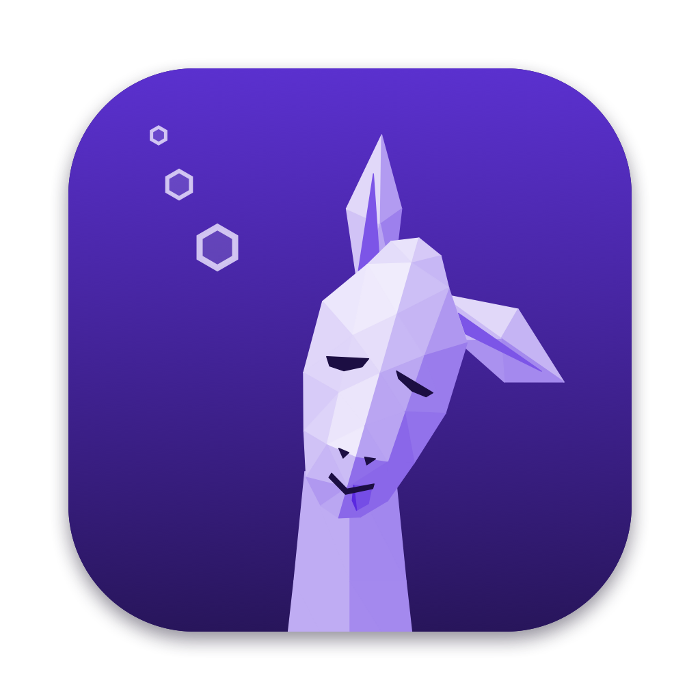
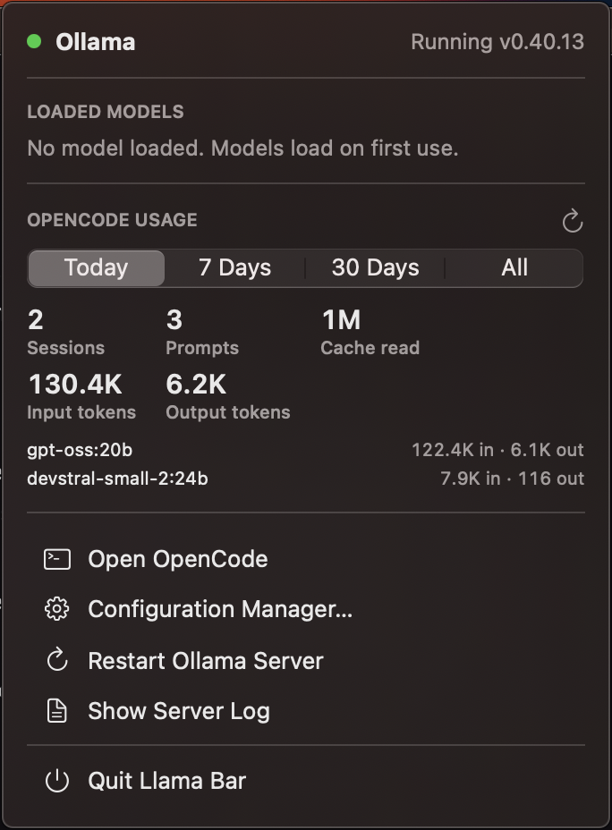

# Llama Bar

A macOS menu bar app for running local [Ollama](https://ollama.com) models, with a
coding-agent setup built on [OpenCode](https://opencode.ai).



- **Spotlight launch:** Cmd+Space, "Llama Bar". Launching starts the Ollama server if it is down.
- **Menu bar status:** a llama that shows memory use while a model is loaded and dims when Ollama is down.
  Click it for server status, loaded models, and OpenCode token usage (today, 7 days, 30 days, all time).
- **Configuration Manager:** pull models from the Ollama library with progress, see installed
  models, choose the default model, load, unload, or delete models, and tune the server's
  context length and keep-alive.
- **OpenCode launcher:** `opencode-ollama` runs OpenCode with every installed Ollama model,
  in a terminal or as a provider for apps such as T3 Code.

Ollama runs natively as a LaunchAgent so it gets the Apple Silicon GPU (Docker on macOS cannot).

```
Llama Bar ──> Ollama :11434 (LaunchAgent, Metal GPU) <── opencode-ollama ──> OpenCode
```

Llama Bar is an independent project and is not affiliated with Ollama or OpenCode.

## Requirements

- macOS 15 or later, Apple Silicon recommended
- [Homebrew](https://brew.sh)
- Xcode or the Command Line Tools (`xcode-select --install`) to build the app
- No other Ollama server running: quit the Ollama desktop app, and `bin/setup` stops
  `brew services ollama`. Both would compete for port 11434.

## Install

### Download (recommended)

1. Download `Llama-Bar-<version>.zip` from [Releases](https://github.com/mcrolf/llama-bar/releases)
   and move **Llama Bar.app** to Applications. Releases are signed and notarized by Apple.
2. Open it (Cmd+Space, "Llama Bar"), click the llama in the menu bar, and choose
   **Run Setup in Terminal**. Setup installs Ollama and OpenCode with Homebrew, starts the
   Ollama server, and downloads the default model (`devstral-small-2:24b`, 15 GB).

Its scripts and settings live in `~/Library/Application Support/Llama Bar`.

Downloads update themselves: Llama Bar checks GitHub for a new release once a day and
offers to install it, or choose **Check for Updates…** in the menu bar panel. Updates are
verified with the release's signing key before they install, and keep your settings. Versions
before 1.1.0 can't update themselves; download the latest release once to get updates.

### Build from source

```sh
git clone https://github.com/mcrolf/llama-bar.git
cd llama-bar
bin/setup       # installs ollama + opencode, starts the LaunchAgent, pulls the default model
bin/build-app   # builds ~/Applications/Llama Bar.app and launches it
```

A source build drives the clone it was built from, so keep the clone in place (or rerun
`bin/build-app` after moving it). To start with a different model, copy `.env.example` to
`.env` and edit it before running `bin/setup`.

## Using it

**Menu bar panel.** Shows whether Ollama is running, which models are loaded (with an eject
button to unload), and OpenCode usage from `opencode stats`: sessions, prompts, and tokens per
model. Actions: open OpenCode in iTerm or Terminal, open the Configuration Manager, restart the
Ollama server, show the server log, and (downloads only) check for updates.

**Configuration Manager.**

- *Installed Models*: size, parameters, and quantization. Right-click or use the buttons to set
  the default, load, unload, or delete.
- *Install Model*: enter any `name:tag` from [ollama.com/library](https://ollama.com/library).
- *Default Model*: the model OpenCode starts new sessions with, plus server context length and
  keep-alive. Settings are saved to `.env`; changing a server setting restarts Ollama, which
  unloads loaded models.

**OpenCode.** Setup links `opencode-ollama` into `~/.local/bin`. Run it for the OpenCode TUI,
or point an app that supports OpenCode at it as the binary path. For T3 Code: add a provider
with driver **OpenCode** and binary path `~/.local/bin/opencode-ollama` (expanded to a full path).
Each start lists every installed model; new models appear the next time OpenCode starts.

Models that handle tool calls well work best for agentic coding:

| Model | Size | SWE-bench Verified | Speed (M4 Max) |
|---|---|---|---|
| devstral-small-2:24b (default) | 15 GB | 68.0% (Mistral) | ~29 tok/s |
| gpt-oss:20b | 13 GB | ~60.7% (OpenAI) | ~90 tok/s |

## Configuration

`.env` (in the clone, or `~/Library/Application Support/Llama Bar` for downloads) holds the settings the Configuration Manager edits:

| Variable | Default | Meaning |
|---|---|---|
| `OLLAMA_MODEL` | `devstral-small-2:24b` | Default model for new OpenCode sessions |
| `OLLAMA_CONTEXT_LENGTH` | `32768` | Context window; agent prompts need at least 32k |
| `OLLAMA_KEEP_ALIVE` | `30m` | How long an idle model stays in memory (`-1` keeps it loaded) |

After editing `.env` by hand, run `bin/configure-server` to apply server settings.
Server log: `~/Library/Logs/llama-bar/ollama.log`.

## Uninstall

```sh
bin/uninstall   # removes the app, the LaunchAgent, settings, and the opencode-ollama link
```

For a download, run `~/Library/Application\ Support/Llama\ Bar/bin/uninstall`.

Ollama, OpenCode, and downloaded models stay installed (`ollama rm <model>` frees disk space).

## Development

```sh
swift test --package-path app                 # app tests
python3 -m unittest discover -s opencode      # config generator tests
LLAMA_BAR_ROOT=$PWD swift run --package-path app   # run the app without bundling
```

Releases (maintainer): save notarization credentials once, then build, tag, and upload.
Use an App Store Connect API key (Users and Access > Integrations > App Store Connect API,
a Team key with the Developer role) rather than an Apple ID: failed Apple ID sign-ins can
lock the account.

```sh
xcrun notarytool store-credentials llama-bar --key AuthKey_<KEYID>.p8 --key-id <KEYID> --issuer <ISSUER_ID>
bin/release 1.1.0     # signs, notarizes, writes the zip and appcast.xml, publishes GitHub release v1.1.0
```

Updates use [Sparkle](https://sparkle-project.org). Installed apps read `appcast.xml` from
the latest GitHub release and only install archives signed with the update key, which lives
in the maintainer's login keychain (account `llama-bar`). Back it up; without it, installed
copies can't be updated:

```sh
app/.build/artifacts/sparkle/Sparkle/bin/generate_keys --account llama-bar -x llama-bar-update-key   # export
app/.build/artifacts/sparkle/Sparkle/bin/generate_keys --account llama-bar -f llama-bar-update-key   # restore
```

Every release must include `appcast.xml`; `bin/release` uploads it. A release without it
leaves installed copies unable to find later updates until one with it is published.

| Path | Purpose |
|---|---|
| `app/` | SwiftUI menu bar app (Swift package) |
| `bin/setup` | Installs dependencies and pulls the default model |
| `bin/configure-server` | Renders the LaunchAgent from `.env` and restarts Ollama |
| `bin/build-app` | Builds and installs `Llama Bar.app`, or packages a notarized release and its update feed |
| `bin/release` | Publishes a release to GitHub with its update feed |
| `bin/uninstall` | Removes the app, LaunchAgent, and settings |
| `bin/opencode-ollama` | OpenCode launcher; generates its config from installed models |
| `opencode/` | OpenCode config template and generator |
| `launchd/` | LaunchAgent template for `ollama serve` |
| `compose.yaml` | Optional CPU-only Docker fallback; don't run it alongside the LaunchAgent |

## License

[MIT](LICENSE)
